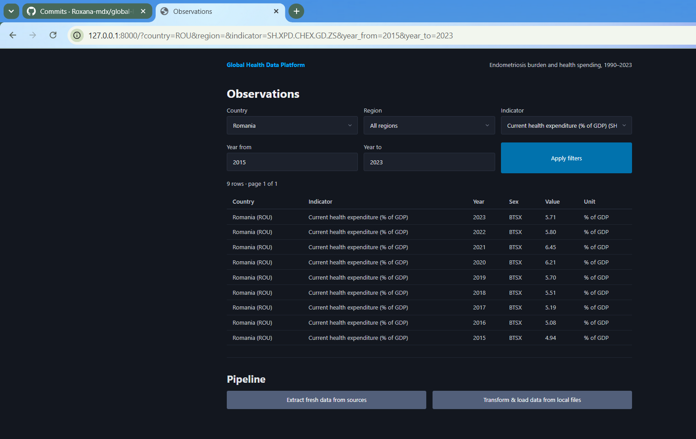
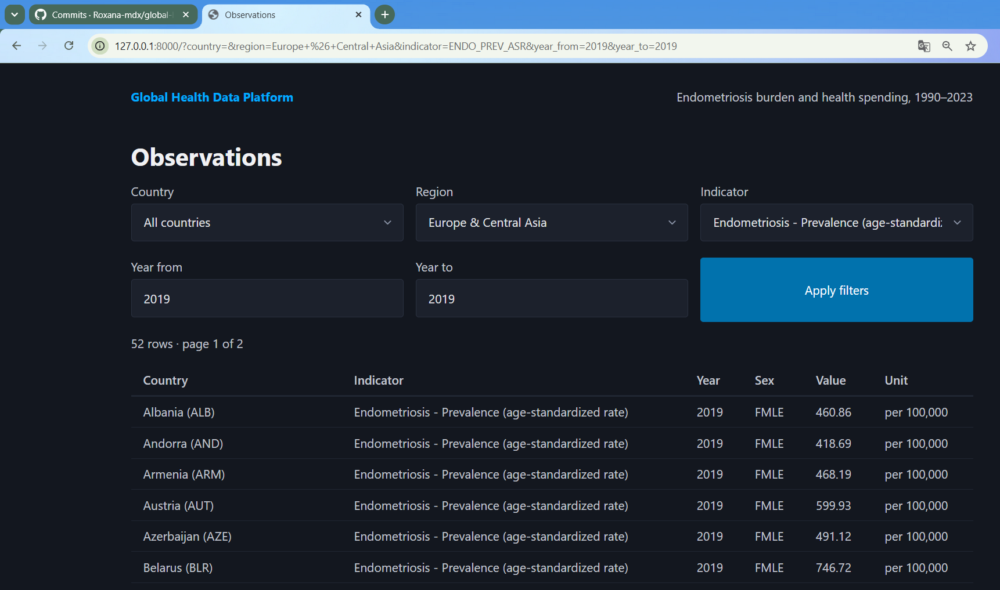
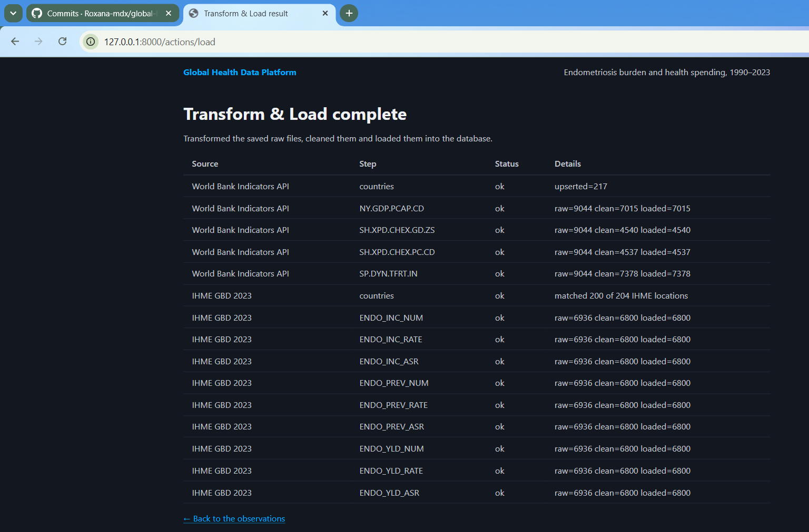

# Lab 3 – Results

Application: server-side rendered page (FastAPI + Jinja2) over the data of lab 2.
Start: `uvicorn app.main:app --reload`, then open `http://127.0.0.1:8000`.

## Task 3.1 – Screenshots

### Filter combination 1: Romania, health expenditure (% of GDP), 2015–2023

### Filter combination 2: Europe & Central Asia, endometriosis prevalence (age-standardized), 2019

URL of the request: `http://127.0.0.1:8000/?country=&region=Europe+%26+Central+Asia&indicator=ENDO_PREV_ASR&year_from=2019&year_to=2019`

Result: 52 rows on 2 pages (52 countries x 1 year, 50 rows per page).

Chain of calls that answered this request:

1. The browser sends `GET /` with the filters in the query string (the form uses `method="get"`).
2. `observation_criteria()` in `app/controllers/observation_controller.py` turns the query string into an `ObservationCriteria` (blank or invalid values are ignored).
3. `show_observations()` in the same file (the controller) receives the criteria and an `ObservationService` built by `get_observation_service()` in `app/dependencies.py`.
4. `ObservationService.get_page(criteria, page)` in `app/services/observation_service.py` turns the page number into `limit` and `offset`.
5. `ObservationRepository.find(criteria, limit=..., offset=...)` and `ObservationRepository.count(criteria)` in `app/repositories/observation_repository.py` build the SQL (`_matching_observations()` and `_conditions()`) and return `ObservationListItem` objects and the total.
6. `ObservationService.get_filter_options()` calls `ObservationRepository.get_filter_options()` (`list_countries()`, `list_indicators()`, `list_regions()`) for the drop-down lists.
7. The controller passes the `ObservationPage`, the criteria and the options to the template `observations.html` and returns the rendered HTML.

### Action result page: Transform & load

The button sends `POST /actions/load`. `transform_and_load()` in `app/controllers/etl_controller.py` calls `EtlService.transform_and_load_all()`, which runs `import_all()` of each source (`etl/import_worldbank.py`, then `etl/import_ihme.py`) and shows the 15 `StepResult` objects with `action_result.html`.

## Task 3.2 – The region filter through every layer

1. **Form field (`app/templates/observations.html`).** The filters form uses `method="get"` and contains `<select name="region">`. Its options come from `options.regions`; the option whose value equals `criteria.region` gets `selected`, so the choice is kept after the page reloads. When the form is submitted, the browser adds `region=...` to the URL (for example `/?region=Sub-Saharan+Africa`).
2. **`observation_criteria()` (`app/controllers/observation_controller.py`).** FastAPI fills its parameter `region: str | None = None` from the query string, and `blank_to_none(region)` turns an empty value (the "All regions" choice) into `None`, which means "do not filter".
3. **`ObservationCriteria.region` (`app/domain.py`).** The value travels in a frozen dataclass with the field `region: str | None = None`. The controller builds it, the service passes it on and the repository reads it; no layer can change it.
4. **`_conditions()` (`app/repositories/observation_repository.py`).** If `criteria.region is not None`, it adds the condition `Country.region == criteria.region`, which becomes `WHERE country.region = :region_1` in SQL. The value is sent as a parameter, which prevents SQL injection. `find()` and `count()` use the same conditions, so the page and the total always agree.
5. **Drop-down list from `FilterOptions.regions`.** `ObservationRepository.list_regions()` selects the distinct non-null `country.region` values in order and returns `Option(value=region, label=region)`; `ObservationService.get_filter_options()` returns them in a `FilterOptions`, the controller passes them to the template as `options`, and the template loops over `options.regions` to write the `<option>` tags.
6. **Why the filter is kept on the next page.** In `show_observations()`, `page_url(number)` uses `request.url.include_query_params(page=number)`, which keeps every other query parameter. The "Next" link is therefore `/?region=Sub-Saharan+Africa&page=2`. The server remembers nothing between requests: the criteria are rebuilt from the query string each time.

Check in the browser: `http://127.0.0.1:8000/?region=Sub-Saharan+Africa`, then "Next": <write what you saw, e.g. the URL of page 2 still contains `region=Sub-Saharan+Africa`, the "Region" field still shows Sub-Saharan Africa and all rows belong to countries of that region>.